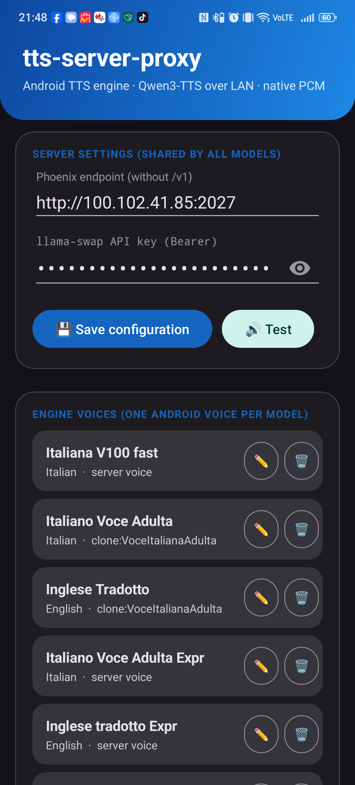
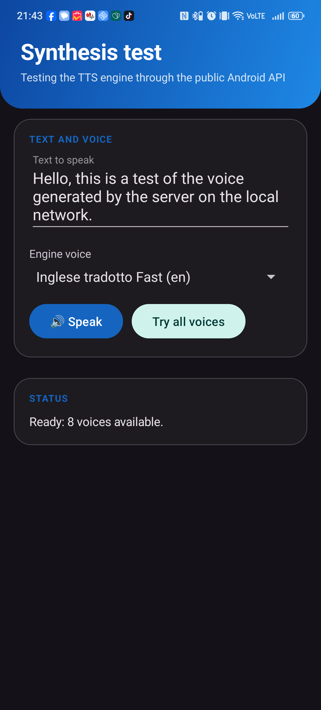
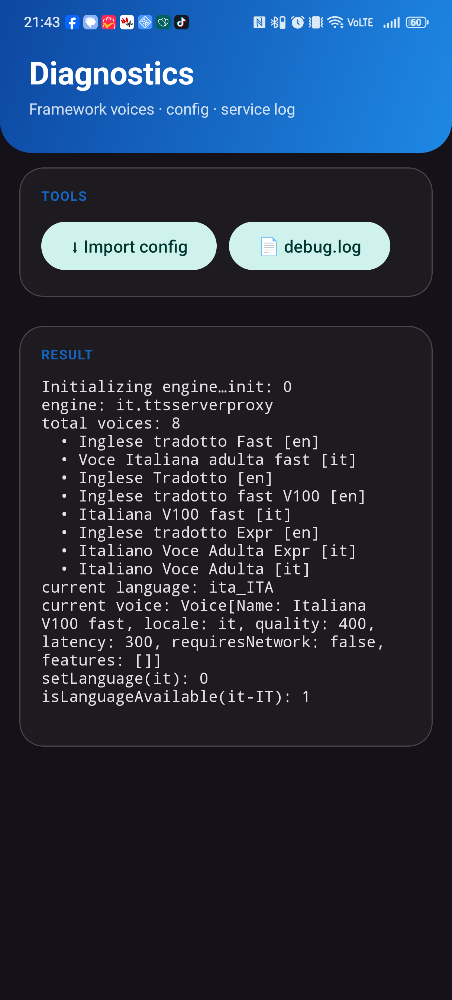

<div align="center">

# 🔊 tts-server-proxy

**A real Android system TTS engine that speaks with your own self-hosted Qwen3-TTS voices.**

Every app on your phone — readers, assistants, accessibility tools — talks with the voices
running on **your GPU, on your LAN**. No cloud, no subscriptions, no per-character fees.


[Installation](#-installation) · [How it works](#-how-it-works) · [Server setup](#-server-side) · [Troubleshooting](#-troubleshooting)

</div>

---

## 🤔 Why

Android's built-in TTS voices are robotic, locked to Google's cloud, or missing entirely for
your language. If you run a **Qwen3-TTS** server (or any OpenAI-compatible speech endpoint)
you already have great, clonable voices — but Android apps can't use them.

**tts-server-proxy** bridges that gap: it installs as a *first-class* `TextToSpeechService`,
so it appears in **Settings → System → Languages & input → Text-to-speech output** like any
commercial engine. Whatever the system asks it to speak, it synthesizes on your server and
streams back to the app that requested it.

Use cases:

- 📚 Read e-books and articles with a cloned voice you actually like
- 🗣️ Accessibility: give your phone a family member's voice
- 🌐 Multi-language setups: one voice per language, switchable by any app
- 🔒 Keep speech **100% on your network** — nothing ever leaves your LAN

## ⚙️ How it works

```
┌──────────────┐  TextToSpeech API   ┌────────────────────┐  OpenAI-compatible   ┌─────────────────────┐
│  Any Android │ ──── bind ────────► │  tts-server-proxy  │ ──── POST ─────────► │  Your GPU server    │
│  app         │ ◄── PCM 16-bit ──── │  (system engine)   │ ◄── WAV/MP3 ──────── │  Qwen3-TTS          │
└──────────────┘                     └────────────────────┘  /v1/audio/speech    └─────────────────────┘
```

The app speaks OpenAI's audio-speech dialect:

```json
POST {endpoint}/v1/audio/speech
{
  "model":  "qwen3-tts-1.7b_G0",
  "voice":  "clone:VoceItalianaAdulta",
  "input":  "Text to speak",
  "response_format": "wav"
}
```

- **Native WAV → PCM** path with zero transcoding; MP3 (or anything `MediaCodec` plays) is
  decoded automatically as a fallback.
- **One model = one Android voice.** Configure as many as you want, per language; apps pick
  them with the standard voice picker.
- **Cold-start proof**: if your server is asleep, the engine waits (wake-on-LAN + boot +
  model load can take minutes — read timeout is 420 s), runs as a **foreground service**
  while synthesizing so Android can't kill it with the screen off, and **retries fast
  network failures** automatically.
- Requests are cancelled silently — no scary "Speech engine problem" dialogs.

## 📱 Installation

### Option A — prebuilt APK

1. Grab `tts-server-proxy-v0.6.0.apk` from the [latest release](../../releases/latest)
   (or from [`apk/`](apk/) in this repository).
2. Install it (allow "install unknown apps" if asked).
3. Open the app: endpoint, model and voice come **pre-filled with a sensible default** —
   edit them, paste your API key, tap **💾 Save configuration**.
4. Select the engine:
   *Settings → System → Languages & input → Text-to-speech output → **tts-server-proxy***
5. Hit **🔊 Test synthesis** inside the app and listen. 🎧

> The engine also works **before you ever open the app**: if no configuration is found,
> built-in defaults are used, so a fresh install (or a reboot) keeps talking.

### Option B — build from source

```bash
git clone https://github.com/manu69x/tts-server-proxy.git
cd tts-server-proxy
export ANDROID_HOME=/path/to/android-sdk
gradle :app:assembleRelease          # or :app:assembleDebug for a debug build
```

Requirements: JDK 17, Android SDK 35, Gradle 8.10+ (AGP 8.6). Release builds expect
`app/keystore.properties` + `app/release.keystore.jks` (not committed — see below);
debug builds work out of the box.

## 🖥️ Server-side

Any endpoint that accepts OpenAI-style `/v1/audio/speech` and returns WAV/MP3 audio will
work. The stack this app was built and tested against:

```
Android phone
  → Phoenix        (wake-on-LAN proxy, OpenAI-compatible front door)
  → llama-swap     (model router / pool, GPU instances)
  → Qwen3-TTS      (FastAPI serving Qwen3-TTS 0.6B/1.7B models on one or more GPUs)
```

You don't need all of that — a single FastAPI service exposing `/v1/audio/speech` is enough.
Quick sanity check from any machine on the LAN:

```bash
curl -X POST http://YOUR_SERVER:PORT/v1/audio/speech \
  -H "Content-Type: application/json" -H "Authorization: Bearer sk-..." \
  -d '{"model":"qwen3-tts-1.7b_G0","voice":"clone:MyVoice","input":"hello","response_format":"wav"}'
```

## 🖼️ Screenshots

| Configuration | Synthesis test | Diagnostics |
|---|---|---|
|  |  |  |

Material 3 UI, follows system dark mode. One model in the list = one voice in Android's
voice picker.

## 🧰 Features

- ✅ Genuine system TTS engine (`TextToSpeechService`, `BIND_TEXT_TO_SPEECH_ENGINE`)
- ✅ Android 8.0+ (API 26), tested on Android 15/16
- ✅ Unlimited models/voices, per-language, switchable from any app
- ✅ Material 3, dark mode, zero-clutter setup with working defaults
- ✅ Foreground service + progress notification during synthesis
- ✅ Config backup/restore via `adb push` (one-tap import in the Diagnostics screen)
- ✅ In-app service log (works even on ROMs where `logcat` is disabled)
- ✅ API key stored only on the device, sent as `Authorization: Bearer`
- ✅ Zero telemetry, zero cloud

## 🚑 Troubleshooting

| Symptom | Cause / fix |
|---|---|
| Engine doesn't appear in the TTS list | Reboot once after install; the engine registers itself — no account needed |
| First synthesis takes 10 s–3 min | **Cold start**: the server wakes and loads the model. Next requests are fast (~3 s) |
| "Speech engine problem" dialog | Update to ≥ v0.3.2 — cancelled requests no longer surface errors |
| No audio on some servers | The app auto-detects MP3 and decodes it; ensure the endpoint returns valid audio |
| Wrong voice used by default | The engine picks the **first model matching the requested language** — order your model list accordingly |
| Need to see what's happening | Open **Diagnostics** → *📄 debug.log*: the service logs every synthesis step there |

## 🔐 Privacy & security

Speech, text and API key never leave your LAN. HTTP is used in cleartext by design — run it
on a network you trust (or wire up TLS on your front proxy). Signing keys are **not** in this
repository: `app/keystore.properties` and `app/release.keystore.jks` are gitignored; generate
your own with `keytool` to sign your builds.

## 📄 License

[MIT](LICENSE) — © 2026 Emanuele Viani

---

<div align="center">

Built with 🎧 by [@manu69x](https://github.com/manu69x) — voices by [Qwen3-TTS](https://github.com/QwenLM/Qwen3), routing by [llama-swap](https://github.com/mostlygeek/llama-swap).

</div>
